<!-- Generated by robeul-console/readme/build.ts from src/data.ts. Edit the data, not this file. -->

 

 

 

 

  

 

 

 

<picture>
  <source media="(prefers-color-scheme: dark)" srcset="https://raw.githubusercontent.com/robeul-trusted-leads/robeul-trusted-leads/output/github-snake-dark.svg" />
  
</picture>

  

  

