<!-- Generated by robeul-console/readme/build.ts from src/data.ts. Edit the data, not this file. -->

<a href="https://mdrobeulislam1251-ux.github.io/robeul-console/"></a>

  

 

<a href="https://mdrobeulislam1251-ux.github.io/robeul-console/#/pipeline"></a>

 

<a href="https://mdrobeulislam1251-ux.github.io/robeul-console/#/experience"></a>

<a href="https://mdrobeulislam1251-ux.github.io/robeul-console/#/experience/trusted-leads"></a>

<a href="https://mdrobeulislam1251-ux.github.io/robeul-console/#/experience/lead-gen-jay"></a>

<a href="https://mdrobeulislam1251-ux.github.io/robeul-console/#/experience/tex-llm"></a>

<a href="https://mdrobeulislam1251-ux.github.io/robeul-console/#/experience"></a>

  

<a href="https://mdrobeulislam1251-ux.github.io/robeul-console/#/projects"></a>

<a href="https://mdrobeulislam1251-ux.github.io/robeul-console/#/projects/apollo-orchestrator"></a>
<a href="https://mdrobeulislam1251-ux.github.io/robeul-console/#/projects/lead-search"></a>
 
<a href="https://mdrobeulislam1251-ux.github.io/robeul-console/#/projects/contacts-core"></a>
<a href="https://mdrobeulislam1251-ux.github.io/robeul-console/#/projects/index-migration"></a>
 
<a href="https://mdrobeulislam1251-ux.github.io/robeul-console/#/projects/infra-fleet"></a>
<a href="https://mdrobeulislam1251-ux.github.io/robeul-console/#/projects/n8n-platform"></a>
 
<a href="https://mdrobeulislam1251-ux.github.io/robeul-console/#/projects/verification-gated-agents"></a>
<a href="https://mdrobeulislam1251-ux.github.io/robeul-console/#/projects/tex-runpack"></a>
 
<a href="https://mdrobeulislam1251-ux.github.io/robeul-console/#/projects"></a>

  

<a href="https://mdrobeulislam1251-ux.github.io/robeul-console/#/stack"></a>

<a href="https://mdrobeulislam1251-ux.github.io/robeul-console/#/stack"></a>

<a href="https://mdrobeulislam1251-ux.github.io/robeul-console/#/stack"></a>

  

<b>Every skill, as a table</b>

 

| Track | What I actually use |
|---|---|
| **Server management** | Server management, Ubuntu fleet operations, Provisioning from one script, Pull-based deploys with rollback, Fleet audits, Disk & capacity management, Monitoring & health checks, Coolify, Docker, Docker Compose |
| **System administration** | System administration, Linux, Ubuntu, systemd services & timers, Backups tested by restore, PostgreSQL administration, Access control & least privilege, PM2, Windows automation, KVM |
| **Networking engineering** | Networking engineering, Tailscale, WireGuard, Cloudflare Tunnels, DNS, Caddy, Nginx, Let's Encrypt TLS, UFW firewalls, MikroTik RouterOS, SPF · DKIM · DMARC, Host-to-host migrations |
| **Automation workflows** | Automation workflows, n8n, n8n queue mode, Custom n8n nodes, Webhooks, Scheduled jobs, GitHub Actions, Google Sheets, Asana, Linear |
| **Pattern understanding** | Pattern understanding, Root-cause diagnosis, Data-quality auditing, Dedup & identity resolution, Taxonomy normalisation, Intent scoring, ICP analysis, Drift & parity checks |
| **AI & Agents** | Claude Agent SDK, Claude Code, Multi-agent orchestration, MCP, Prompt & context engineering, Retrieval & vector search, vLLM, Qwen, Chat-ops agents |
| **Data** | Python, PostgreSQL, Supabase, Elasticsearch, OpenSearch, ClickHouse, ETL / ELT, Scraping at scale, Waterfall verification, Schema design, Warehouse modelling |
| **APIs & Integrations** | REST / RPC API design, GraphQL, OpenAPI, MCP servers, FastAPI, Express, KrakenD, Authgear, Stripe |
| **GTM Systems** | Apollo.io, ICP design & segmentation, B2B list building, Enrichment, MillionVerifier, Reacher, Deliverability, Smartlead, Instantly, HubSpot, RevOps data modelling |
| **Apps & Languages** | Python, TypeScript, JavaScript, SQL, Bash, Next.js, React, Node.js, Kotlin, Android, Swift |
| **Professional** | Team leadership, Directing AI build agents, Client-facing problem solving, Technical documentation & standards, Founding a business, Async remote work with US teams |

 

<a href="https://mdrobeulislam1251-ux.github.io/robeul-console/#/pipeline"></a>

<a href="https://mdrobeulislam1251-ux.github.io/robeul-console/#/pipeline"></a>

 

<a href="https://mdrobeulislam1251-ux.github.io/robeul-console/#/standards"></a>

<a href="https://mdrobeulislam1251-ux.github.io/robeul-console/#/standards"></a>

 

  

  

<picture>
  <source media="(prefers-color-scheme: dark)" srcset="https://raw.githubusercontent.com/robeul-trusted-leads/robeul-trusted-leads/output/github-snake-dark.svg" />
  
</picture>

  

<a href="https://mdrobeulislam1251-ux.github.io/robeul-console/#/contact"></a>

  

