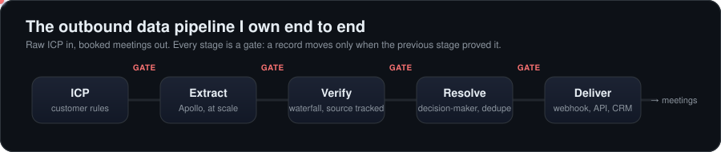

<table>
<tr>
<td width="200" align="center" valign="middle">
  
</td>
<td valign="middle">

### B2B Lead Data · Verification Pipelines · AI Automation

I build the data systems that turn a customer's ICP into an accurate, verified, ready-to-send lead list. At **Trusted Leads** I own the outbound pipeline end to end: extraction, waterfall verification, decision-maker resolution and delivery. At **Lead Gen Jay** I ship lead lists at volume. With **T-Ex LLM** I build multi-agent AI systems that are verified before they are allowed to say "done".

 

</td>
</tr>
</table>

 

## 💼 Experience

<table>
<tr>
<td width="72" align="center" valign="top"></td>
<td valign="top">

**Head Data Engineer · [Trusted Leads](https://trustedleads.io)**
Aug 2024 – Present · Full-time · Remote · St. Petersburg, FL (US)

Own the outbound data infrastructure end to end: the extraction engine and the pipeline it feeds. ICP-based prospect extraction from Apollo.io, driven by each customer's own targeting rules. Waterfall email verification across several providers, with the source tracked on every record. Decision-maker resolution, deduplication against past deliveries, schema-consistent normalisation. Delivery by webhook and direct API into Smartlead, Instantly and customer CRMs. Lead the data engineering team and set the schema and verification standards.

        

</td>
</tr>
<tr>
<td width="72" align="center" valign="top"></td>
<td valign="top">

**Senior Data Engineer · [Lead Gen Jay](https://leadgenjay.com)**
Aug 2024 – Present · Contract · Remote · St. Petersburg, FL (US)

Large-scale prospect extraction, enrichment and verification for a data team that ships lead lists at volume. ICP segmentation and list building against each customer's targeting criteria. Email verification and data-quality checks before delivery, so every list is ready to send. When a campaign underperforms, find the cause (list building, data accuracy or mailbox health) and fix the pipeline upstream so it does not happen again.

      

</td>
</tr>
<tr>
<td width="72" align="center" valign="top"></td>
<td valign="top">

**Builder · [T-Ex LLM](https://github.com/mdrobeulislam1251-ux/T-Ex-LLM-Runpack)**
2026 – Present · Multi-agent AI systems

A company-in-a-box for terminal AI: 53 specialist agents in 9 teams, 44 doctrine skills, a switchable company brain and hard review gates. Ships as a Claude Code plugin, a standalone launcher, and a self-hosted runtime with WhatsApp / Telegram channels. Every agent is verification-gated, so nothing is reported done until it ran and was observed passing.

     

</td>
</tr>
</table>

 

## 🧩 Selected projects

| | Project | What it does |
|:--:|---|---|
|  | **Distributed Apollo scraping orchestrator** · 2025, Trusted Leads | Seven n8n workflows: session intake, keep-alive probing, account warm-up promotion, order intake, job splitting, scrape dispatch, worker callbacks, plus a shared error-handling workflow. Manages a pool of authenticated sessions, promotes warmed accounts, retires failed ones, and splits large orders into parallel jobs. Job state lives in versioned PostgreSQL tables, so every order has an auditable record from intake to delivery.  n8n · PostgreSQL · Python · Docker · webhooks |
|  | **Self-hosted infrastructure fleet** · 2024, Trusted Leads | Designed and run the servers the pipelines use, split by role across several regions, plus a main container host for scraping, agent tooling and document processing. All server-to-server traffic goes over a private Tailscale network. No service is public unless deliberately published.  Docker Compose · Ubuntu · Tailscale · Cloudflare · UFW · systemd · Caddy · libvirt/KVM |
|  | **Lead search dashboard** · Trusted Leads | Internal search over ~17.4M B2B contacts with 69 filter fields and exports up to 600k rows. Elasticsearch for raw scrape, Postgres as the system of record, OpenSearch via an outbox, and a verifier that alone may mark a row valid.  PostgreSQL · Elasticsearch · OpenSearch · Python |
|  | **Verification-gated multi-agent system** · 2026, T-Ex LLM | Built to stop AI coding agents from reporting work as complete when it never ran. Stop hooks keep an agent from ending its turn until a verification gate passes. Guards catch destructive commands. Role locks stop a builder approving its own work. A separate reviewer model checks the builder, and a budget circuit breaker kills runaway loops.  Claude Agent SDK · TypeScript · Supabase · MCP · Coolify · Vercel |
|  | **[T-Ex LLM Runpack](https://github.com/mdrobeulislam1251-ux/T-Ex-LLM-Runpack)** · 2026, T-Ex LLM | Per-engineer AI agent environments: a ready-to-deploy setup each engineer runs on their own server, with a private network, individually issued keys, remote SSH development and one branch per engineer. Per-project context files make new engineers productive on day one.  Claude Code · Tailscale · Git · Linux · VS Code Remote-SSH |

 

## 🛠️ Skills

| Track | What I actually use |
|---|---|
| **AI & Agents** | Claude Agent SDK, Claude Code, multi-agent orchestration, MCP, agent reliability and enforcement hooks, prompt and context engineering, local LLM inference (vLLM, Qwen), retrieval and personalisation pipelines, AI-assisted prototyping |
| **Data** | Python, PostgreSQL, Supabase, ETL / ELT pipelines, web scraping at scale, waterfall verification, deduplication and identity resolution, schema design, data-quality auditing |
| **Automation & APIs** | n8n multi-workflow systems and error workflows, REST / RPC API design, webhooks, Next.js API routes, FastAPI, Express, API gateways (KrakenD), auth (Authgear), rate limiting and retries |
| **GTM Systems** | Apollo.io, ICP design and segmentation, B2B list building, enrichment, email verification (MillionVerifier, Reacher), deliverability, Smartlead, Instantly, CRM integration, RevOps data modelling |
| **Infrastructure** | Docker, Docker Compose, Linux (Ubuntu), Coolify, Tailscale, Cloudflare Tunnels, Caddy, AWS SES, DNS, UFW, systemd, KVM virtualisation, Vercel, server migration |
| **Languages** | Python, TypeScript, JavaScript, SQL, Bash · Next.js, React, Node.js |
| **Professional** | Team leadership, root-cause diagnosis, client-facing problem solving, technical documentation and standards, async remote work with US teams |

  

GTM tools I run every day 
&nbsp;&nbsp;
&nbsp;&nbsp;
&nbsp;&nbsp;
&nbsp;&nbsp;
&nbsp;&nbsp;

 

## 🔄 The pipeline

 

## 📜 How I work

### `NO GUESS` · `NO TRUST` · `GREEN CHECK` · `STOP ON RED` · `IDEMPOTENT` · `NO FAKE DONE`

| # | Rule | What it means in practice |
|:-:|---|---|
| 1 | **Stop at the endpoint** | count ≠ pull ≠ deliver. Do the named step, then stop. |
| 2 | **No client file** until row count and ICP are approved | Reputation is the product. A bad list costs more than a late one. |
| 3 | **No auto-spend** | No credits, no paid API calls, no purchases without a named go. |
| 4 | **No paid recommendations** without a test | Prove it on a sample before proposing the spend. |
| 5 | **Verify before claim** | "Done" means it ran and was observed passing. Exit code 0 means compiled, never works. |

 

## 📊 Stats

 

  

 

<picture>
  <source media="(prefers-color-scheme: dark)" srcset="https://raw.githubusercontent.com/robeul-trusted-leads/robeul-trusted-leads/output/github-snake-dark.svg" />
  
</picture>

 

## 🤝 Connect

  
Remote on US hours from Bangladesh. Accurate lead lists that drive real business growth.

